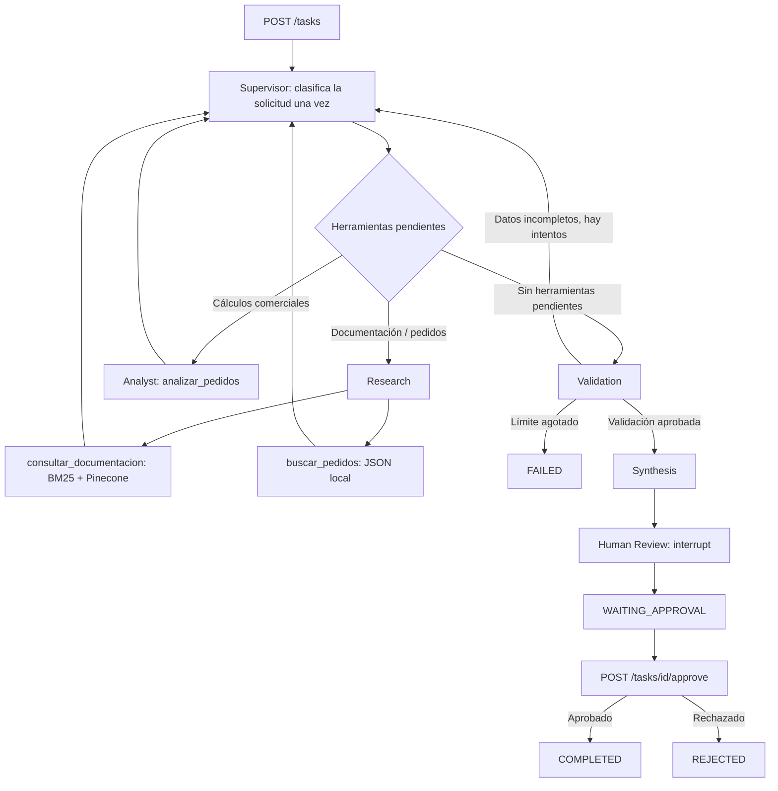

# Trabajo Final · AI Engineering | Sistema multiagente con RAG

Proyecto que integra **FastAPI**, **LangGraph**, agentes especializados, recuperación documental híbrida (**BM25 + Pinecone**), **Redis Stack**, revisión humana (**HITL**) y observabilidad con **LangSmith**.

> Rama de entrega: `trabajo-final`. Requiere Python 3.12 (Docker). Las claves API, el índice externo de Pinecone y el proyecto de LangSmith son servicios externos: no se almacenan en Git.

## Arquitectura



Los seis nodos son `supervisor`, `research`, `analyst`, `validation`, `synthesis`, `human_review`. La planificación usa salida estructurada Pydantic; los especialistas, la síntesis, el grafo y el checkpointer disponen de API asíncrona (`ainvoke`, `aget_state`, `AsyncRedisSaver`). El recuperador híbrido expone `ainvoke`; internamente algunas integraciones pueden delegar operaciones bloqueantes a hilos.

### Componentes

- **Research:** consulta pedidos con `buscar_pedidos` o documentación técnica con `consultar_documentacion`.
- **RAG:** BM25 local (peso 0,4) y Pinecone (peso 0,6), resultados con fuente y categoría. `app/rag/data` incluye cinco documentos Markdown de ejemplo. Hay cinco chunks con el corpus original; no se afirma calidad estadística con este conjunto reducido.
- **Analyst:** cálculos comerciales mediante `analizar_pedidos`; no es necesario para preguntas documentales.
- **Validation:** comprueba herramientas según el plan de cada solicitud. Si no se completa tras seis pasos, finaliza como `FAILED`, sin pasar a HITL.
- **HITL:** `interrupt()` y `Command(resume=...)`, con decisión estructurada `approved` / `rejected`.
- **Redis:** `task:{job_id}` para estados y checkpoints LangGraph mediante el `thread_id` de cada tarea.
- **LangSmith:** captura trazas jerárquicas de nodos, LLM, tools, retrievers, tokens y latencia, siempre que el tracing esté habilitado.

## Instalación desde cero con Docker Compose

```bash
git clone -b trabajo-final https://github.com/AlvaroSanchez10/entrega-7-api-agentes.git
cd entrega-7-api-agentes
cp .env.example .env
```

Editar `.env` con `OPENAI_API_KEY`, `PINECONE_API_KEY`, `LANGSMITH_API_KEY` (opcional para ejecución, necesaria para trazas), `LANGSMITH_PROJECT` y demás variables. **No subir `.env` al repositorio**. El valor `REDIS_URL=redis://redis:6379/0` está diseñado para Compose. No reemplazar `redis` por `localhost` dentro del contenedor.

```bash
docker compose up -d --build
docker compose ps
docker compose logs --tail=40 api
```

API y Swagger: `http://localhost:8000/docs`.

### Inicialización de Pinecone (solo la primera vez)

La API arranca sin inicializar Pinecone; cuando se utiliza la herramienta RAG, el índice debe existir y contener los vectores. **La creación del índice, la ingesta y las consultas pueden generar costos externos.**

```bash
docker compose run --rm api python -m app.rag.setup_pinecone
# Una vez que el índice esté operativo:
docker compose run --rm api python -m app.rag.ingest
```

Configuración prevista: índice `technical-rag-index`, namespace `dev`, AWS `us-east-1`, embeddings `text-embedding-3-small` (1536 dimensiones). Repetir la ingesta no es necesario para reiniciar la API; el índice se persiste en Pinecone.

## API REST

| Ruta | Entrada | Respuesta |
|---|---|---|
| `POST /tasks` | `{"prompt":"Consulta Redis en la documentación y cita fuentes."}` | `{"job_id":"UUID","status":"PENDING"}` |
| `GET /tasks/{job_id}` | Sin body | `PENDING`, `RUNNING`, `WAITING_APPROVAL`, `COMPLETED`, `REJECTED`, `FAILED` |
| `POST /tasks/{job_id}/approve` | `{"approved":true}` o `{"approved":false}` | `RUNNING`; luego consultar GET |

Ejemplo de principio a fin:

```bash
curl -s -X POST http://localhost:8000/tasks -H 'Content-Type: application/json' \
  -d '{"prompt":"Consultá documentación mediante RAG y explicá Redis citando redis.md."}'
# Copiar el job_id recibido:
curl -s http://localhost:8000/tasks/JOB_ID
# Solo cuando el estado es WAITING_APPROVAL:
curl -s -X POST http://localhost:8000/tasks/JOB_ID/approve \
  -H 'Content-Type: application/json' -d '{"approved":true}'
curl -s http://localhost:8000/tasks/JOB_ID
```

La API crea tareas en segundo plano dentro del proceso: **no es una cola durable de producción**. Redis persiste estados y checkpoints, pero un reinicio puede dejar tareas `RUNNING` sin reprogramación automática. No hay autorización ni autenticación HTTP; se utiliza con fines académicos en un entorno de desarrollo.

## Pruebas

Pruebas automatizadas sin llamadas pagas a OpenAI, Pinecone ni LangSmith:

```bash
docker compose run --rm api python -m pytest -q
```

Incluyen endpoints, decisiones de HITL simuladas a nivel API, validación documental/comercial, límite de pasos, supervisor sin repetición y una prueba del **interrupt/resume real** de LangGraph usando `MemorySaver`.

La prueba de concurrencia hace **cinco ejecuciones reales** y aprueba cada solicitud automáticamente al llegar a HITL, con un límite de 180 segundos por tarea; **consume OpenAI y puede consumir Pinecone**:

```bash
python test_concurrencia.py
```

No ejecutar como comprobación rutinaria. La medición actual de concurrencia debe repetirse tras cambios para obtener datos finales comparables.

## Observabilidad y evidencia

Proyecto LangSmith configurado: `ai-engineering-trabajo-final`.

**Línea base real previa a la optimización** (consulta documental sobre Redis; obtenida desde LangSmith):

| Métrica | Antes de optimizar |
|---|---:|
| Llamadas al modelo | 20 |
| Tokens de LLM (registrados) | 28.913 |
| Herramientas ejecutadas | 6 (5 RAG, 1 analizar_pedidos) |
| Duración del grafo | 30,79 s |

Traza de línea base: `01a1a691-6ad7-7361-833a-5d81edbcd5a0`. La aprobación posterior quedó registrada como otra traza: `01a1a697-7625-764f-92ba-3255989a1092`. La traza del error antiguo es `01a1a68e-5ca7-710d-92e1-8d95f9a2d4e2`.

**Pendiente de medir**: una ejecución posterior a la optimización, uso de tokens, número de herramientas, latencias y capturas de **cinco trazas** exigidas en la consigna. No atribuir mejoras cuantificadas sin ejecutar esas mediciones.

La carpeta `screenshots/` contiene capturas antiguas de la Pre-entrega 7 y no debe presentarse como evidencia de la versión final sin verificar fecha y correspondencia.

## Limitaciones conocidas

- Python 3.12 y servicios externos con credenciales válidas para la ejecución integral.
- Pinecone requiere índice y documentos previamente cargados.
- BM25 y el vector store pueden usar hilos internos aunque se invoquen con API asíncrona.
- Pequeño corpus documental, sin evaluación de calidad concluyente.
- El routing clasifica una vez con un LLM; si la clasificación inicial es errónea, la respuesta puede no cubrir la intención de la consulta.
- El estado `RUNNING` no se recupera automáticamente tras caídas del proceso; el control concurrente de aprobaciones no está diseñado para producción.
- Sin autenticación ni autorización de endpoints: usar solo en entorno restringido de demostración.

## Autor

Álvaro Sánchez · Trabajo Final de AI Engineering, Coderhouse.
