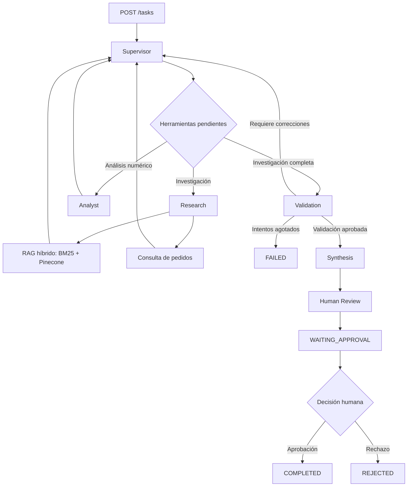

# Trabajo Final | AI Engineering
## Sistema multiagente con RAG híbrido, LangGraph y FastAPI

### Descripción del proyecto

Este proyecto desarrolla un sistema multiagente de inteligencia artificial capaz de procesar solicitudes comerciales y consultas documentales mediante una arquitectura de agentes especializados.

La solución integra **FastAPI, LangGraph, LangChain, Redis Stack, Pinecone, OpenAI y LangSmith**, incorporando recuperación aumentada por generación (RAG), ejecución asíncrona, persistencia de estados, validación de resultados y revisión humana (*Human-in-the-loop*).

El sistema fue desarrollado como Trabajo Final del curso de **AI Engineering de Coderhouse**, integrando componentes construidos durante los módulos anteriores en una única aplicación funcional.

**Repositorio:** https://github.com/AlvaroSanchez10/entrega-8-final

**Rama predeterminada y de entrega:** `trabajo-final`

**Entorno de ejecución:** Python 3.12 mediante Docker.

---

## 1. Objetivos

El objetivo principal es implementar un sistema de agentes de inteligencia artificial coordinados mediante LangGraph, capaces de utilizar herramientas específicas y colaborar para resolver solicitudes de diferentes características.

Los objetivos técnicos son:

- Implementar una arquitectura multiagente con un supervisor que coordine especialistas.
- Integrar recuperación documental híbrida mediante BM25 y Pinecone.
- Exponer el sistema mediante una API REST desarrollada con FastAPI.
- Utilizar ejecución asíncrona para procesar solicitudes.
- Persistir estados y checkpoints mediante Redis.
- Incorporar validación automática y aprobación humana.
- Registrar ejecuciones, latencias y consumo de tokens mediante LangSmith.
- Facilitar la ejecución reproducible con Docker Compose.
- Incorporar pruebas automatizadas y pruebas de concurrencia.

---

## 2. Arquitectura del sistema



La arquitectura utiliza **seis nodos principales**:

1. `supervisor`
2. `research`
3. `analyst`
4. `validation`
5. `synthesis`
6. `human_review`

El supervisor identifica las necesidades de cada solicitud y determina qué especialistas deben intervenir.

El sistema utiliza modelos Pydantic para estructurar decisiones, LangGraph para la orquestación y Redis para conservar los estados de ejecución.

Las operaciones principales del grafo utilizan interfaces asíncronas, incluyendo `ainvoke()`, `aget_state()` y `AsyncRedisSaver`.

Algunas integraciones internas pueden delegar operaciones bloqueantes a hilos, por lo que la asincronía no es necesariamente nativa en todas las dependencias.

---

## 3. Componentes principales

### 3.1. Supervisor

El supervisor interpreta cada solicitud y planifica su ejecución.

Puede clasificar las tareas como:

- **Documentales:** requieren recuperar información técnica.
- **Comerciales:** requieren consultar información de pedidos.
- **Mixtas:** necesitan combinar ambas fuentes.

También determina cuándo debe intervenir el agente de análisis numérico.

Para mejorar el rendimiento, el supervisor clasifica inicialmente la solicitud y después utiliza las contribuciones registradas para determinar qué herramientas continúan pendientes.

Este mecanismo reduce las llamadas innecesarias al modelo y evita repetir investigaciones completadas.

### 3.2. Research Agent

El agente investigador obtiene información mediante dos herramientas.

**`buscar_pedidos`**

Consulta los pedidos comerciales almacenados en un archivo JSON local.

Permite recuperar información de clientes, identificadores de pedidos e importes.

**`consultar_documentacion`**

Consulta documentos técnicos utilizando un sistema RAG híbrido.

La herramienta permite obtener fragmentos de información junto con sus fuentes y categorías.

### 3.3. RAG híbrido

El sistema de recuperación documental integra dos mecanismos:

| Recuperador | Peso | Función |
|---|---:|---|
| BM25 | 0,4 | Recuperación léxica basada en términos |
| Pinecone | 0,6 | Recuperación vectorial por similitud semántica |

Ambos se combinan mediante `EnsembleRetriever`.

Para la búsqueda vectorial se utiliza el modelo de embeddings `text-embedding-3-small` de OpenAI.

**Corpus documental incluido:**

- `fastapi.md`
- `redis.md`
- `postgresql.md`
- `docker.md`
- `kubernetes.md`

Los documentos están ubicados en `app/rag/data/`.

Durante la ingesta inicial se procesaron cinco documentos y se generaron cinco fragmentos, que fueron indexados en Pinecone.

El corpus permite demostrar el funcionamiento de la arquitectura RAG, pero su tamaño reducido no permite afirmar una calidad de recuperación generalizable a bases documentales extensas.

### 3.4. Analyst Agent

El agente analista interviene cuando una solicitud comercial requiere operaciones numéricas.

Utiliza la herramienta `analizar_pedidos`, que permite calcular:

- Cantidad de pedidos.
- Importe total.
- Promedio de importes.

El supervisor evita enviar solicitudes puramente documentales al analista.

### 3.5. Validation

El nodo de validación comprueba que las herramientas requeridas por el plan se hayan ejecutado correctamente.

La validación es contextual: una consulta documental no requiere herramientas comerciales, mientras que una consulta de pedidos debe utilizar las herramientas correspondientes.

Cuando faltan resultados, el sistema puede solicitar nuevas intervenciones de los especialistas.

El flujo contempla un límite máximo de seis pasos de especialistas. Si no se consigue una validación satisfactoria, la tarea finaliza con estado `FAILED`, sin avanzar a la revisión humana.

### 3.6. Synthesis

El nodo de síntesis utiliza las contribuciones validadas para generar una respuesta consolidada.

Su función es integrar la información de los especialistas y preparar el resultado para la revisión humana.

### 3.7. Human-in-the-loop (HITL)

El proyecto incorpora un mecanismo de revisión humana mediante las funcionalidades de LangGraph:

- `interrupt()`
- `Command(resume=...)`

Cuando el sistema genera un resultado, puede interrumpir su ejecución y conservar el estado `WAITING_APPROVAL`.

El usuario puede aprobar o rechazar el resultado mediante un endpoint de FastAPI.

**Estados finales posibles:**

- `COMPLETED`: resultado aprobado.
- `REJECTED`: resultado rechazado.
- `FAILED`: ejecución que no pudo completarse correctamente.

La decisión humana se registra mediante un campo estructurado, evitando depender de comparaciones de texto para detectar rechazos.

---

## 4. Persistencia y gestión de estados

El sistema utiliza Redis Stack para dos funciones diferentes.

### Gestión de tareas

Cada ejecución recibe un identificador único (`job_id`).

Los estados se almacenan utilizando claves con el formato:

`task:{job_id}`

| Estado | Descripción |
|---|---|
| `PENDING` | Tarea creada |
| `RUNNING` | Ejecución en curso |
| `WAITING_APPROVAL` | Esperando decisión humana |
| `COMPLETED` | Finalizada correctamente |
| `REJECTED` | Rechazada por revisión humana |
| `FAILED` | Finalizada con error |

### Checkpoints de LangGraph

Se utiliza `AsyncRedisSaver` para almacenar checkpoints del grafo, asociados al `thread_id` de cada tarea.

Esto permite conservar el contexto necesario para interrumpir y reanudar ejecuciones.

La aplicación no implementa una cola durable de trabajos. Si el proceso se reinicia mientras una tarea está ejecutándose, no existe recuperación automática general de las tareas activas.

---

## 5. Tecnologías utilizadas

| Tecnología | Función |
|---|---|
| Python 3.12 | Lenguaje principal |
| FastAPI | API REST |
| Pydantic | Validación y modelos estructurados |
| LangGraph | Orquestación multiagente |
| LangChain | Agentes y herramientas |
| OpenAI | Modelos de lenguaje y embeddings |
| Pinecone | Base de datos vectorial |
| BM25 | Recuperación léxica |
| Redis Stack | Persistencia de estados y checkpoints |
| LangSmith | Observabilidad y trazabilidad |
| Docker | Contenedorización |
| Docker Compose | Orquestación de servicios |
| pytest | Pruebas automatizadas |
| HTTPX | Cliente HTTP asíncrono |

Las versiones utilizadas se encuentran declaradas en `requirements.txt`.

---

## 6. Instalación y ejecución

### Requisitos previos

- Git.
- Docker y Docker Compose.
- Credenciales válidas de OpenAI.
- Credenciales válidas de Pinecone.
- Credenciales de LangSmith para registrar trazas.

La aplicación se ejecuta con Python 3.12 dentro de Docker, sin requerir una instalación local de Python para levantar la API.

### 6.1. Clonar el repositorio

```bash
git clone https://github.com/AlvaroSanchez10/entrega-8-final.git

cd entrega-8-final
```

La rama predeterminada es `trabajo-final`, por lo que el comando anterior descarga directamente la versión correspondiente a la entrega.

### 6.2. Configurar variables de entorno

Crear un archivo `.env` a partir del ejemplo:

```bash
cp .env.example .env
```

Configurar las variables:

```dotenv
OPENAI_API_KEY=
OPENAI_MODEL=gpt-4.1-mini

REDIS_URL=redis://redis:6379/0

LANGSMITH_TRACING=true
LANGSMITH_API_KEY=
LANGSMITH_PROJECT=ai-engineering-trabajo-final

PINECONE_API_KEY=
INDEX_NAME=technical-rag-index
PINECONE_NAMESPACE=dev
EMBEDDING_MODEL=text-embedding-3-small
```

Las claves privadas deben incorporarse únicamente al archivo `.env`.

**No subir `.env` al repositorio.**

La URL `redis://redis:6379/0` está configurada para que la API pueda comunicarse con Redis mediante la red interna de Docker Compose.

### 6.3. Iniciar los servicios

```bash
docker compose up -d --build
```

Verificar los contenedores:

```bash
docker compose ps
```

Consultar los registros de FastAPI:

```bash
docker compose logs --tail=40 api
```

Una vez iniciado correctamente, la documentación interactiva de la API estará disponible en:

**http://localhost:8000/docs**

### 6.4. Configurar Pinecone

El proyecto incluye los scripts necesarios para crear el índice vectorial y cargar los documentos.

La inicialización es necesaria una sola vez por índice nuevo.

**Crear el índice:**

```bash
docker compose run --rm api python -m app.rag.setup_pinecone
```

Una vez que Pinecone confirme que el índice está operativo, **cargar los documentos:**

```bash
docker compose run --rm api python -m app.rag.ingest
```

Configuración prevista:

| Parámetro | Valor |
|---|---|
| Índice | `technical-rag-index` |
| Namespace | `dev` |
| Cloud | AWS |
| Región | `us-east-1` |
| Modelo de embeddings | `text-embedding-3-small` |
| Dimensiones | 1536 |
| Métrica | Cosine |

El índice y sus vectores permanecen almacenados en Pinecone, por lo que no es necesario repetir la ingesta en cada inicio del sistema.

**Nota:** la creación del índice, la generación de embeddings y las consultas a servicios externos pueden generar costos según los planes utilizados.

---

## 7. API REST

### Crear una tarea

`POST /tasks`

Ejemplo:

```bash
curl -s -X POST http://localhost:8000/tasks \
  -H "Content-Type: application/json" \
  -d '{
    "prompt": "Consultá la documentación técnica y explicá para qué sirve Redis. Citá la fuente."
  }'
```

Respuesta inicial:

```json
{
  "job_id": "UUID_GENERADO",
  "status": "PENDING"
}
```

### Consultar el estado

`GET /tasks/{job_id}`

```bash
curl -s http://localhost:8000/tasks/JOB_ID
```

El endpoint devuelve el estado actual y, cuando corresponde, el resultado final o el error registrado.

### Aprobar o rechazar una tarea

`POST /tasks/{job_id}/approve`

**Aprobar:**

```bash
curl -s -X POST http://localhost:8000/tasks/JOB_ID/approve \
  -H "Content-Type: application/json" \
  -d '{"approved":true}'
```

**Rechazar:**

```bash
curl -s -X POST http://localhost:8000/tasks/JOB_ID/approve \
  -H "Content-Type: application/json" \
  -d '{"approved":false}'
```

Este endpoint debe utilizarse cuando la tarea se encuentra en estado `WAITING_APPROVAL`.

La API confirma inicialmente la recepción de la decisión con estado `RUNNING`. Posteriormente, el resultado definitivo puede consultarse mediante `GET /tasks/{job_id}`.

---

## 8. Pruebas automatizadas

El proyecto incorpora una suite de pruebas desarrollada con pytest.

Para ejecutarla:

```bash
docker compose run --rm api python -m pytest -v
```

### Resultados obtenidos

**Entorno:** Docker, Python 3.12.16 y pytest 9.2.0.

| Indicador | Resultado |
|---|---:|
| Pruebas ejecutadas | 13 |
| Pruebas aprobadas | 13 |
| Pruebas fallidas | 0 |
| Tasa de aprobación | 100 % |

Las pruebas verifican:

- Creación y consulta de tareas.
- Manejo de tareas inexistentes.
- Validación de solicitudes vacías.
- Aprobación y rechazo humano.
- Registro de estados de ejecución.
- Bloqueo de validaciones fallidas.
- Clasificación de solicitudes documentales y comerciales.
- Activación del analista únicamente cuando corresponde.
- Prevención de consultas RAG redundantes.
- Gestión del límite máximo de pasos.
- Interrupción y reanudación real de LangGraph mediante `MemorySaver`.

Las pruebas automatizadas utilizan simulaciones para las dependencias externas y no requieren ejecutar consultas pagas a OpenAI o Pinecone.

---

## 9. Prueba de concurrencia

Se implementó una prueba para verificar el procesamiento simultáneo de solicitudes.

El archivo `test_concurrencia.py` ejecuta cinco tareas comerciales mediante `httpx.AsyncClient` y `asyncio.gather()`.

Cada tarea:

1. Envía una solicitud a FastAPI.
2. Recibe un identificador independiente.
3. Consulta periódicamente su estado.
4. Aprueba automáticamente el resultado al alcanzar `WAITING_APPROVAL`.
5. Verifica que la ejecución alcance `COMPLETED`.

### Resultados reales

| Tarea | Estado final | Duración |
|---|---|---:|
| 1 | COMPLETED | 10,38 s |
| 2 | COMPLETED | 9,08 s |
| 3 | COMPLETED | 8,07 s |
| 4 | COMPLETED | 10,09 s |
| 5 | COMPLETED | 9,06 s |

**Métricas generales:**

| Indicador | Resultado |
|---|---:|
| Tareas simultáneas | 5 |
| Tareas completadas | 5/5 |
| Tasa de éxito | 100 % |
| Tiempo total de la prueba | 10,40 s |
| P95 creación de tareas | 0,267 s |
| P95 duración por tarea | 10,32 s |

La prueba confirma que la API pudo gestionar cinco ejecuciones concurrentes en el escenario evaluado, manteniendo identificadores y estados independientes.

Estos resultados corresponden a una ejecución puntual y no representan una evaluación de carga a gran escala.

### Ejecución opcional

Con la API funcionando y un entorno Python con `httpx` instalado:

```bash
python test_concurrencia.py
```

La prueba utiliza servicios reales y puede generar consumo de API. No debe ejecutarse como parte de las comprobaciones rutinarias.

**Evidencia:** [Prueba de concurrencia](evidencias/06_concurrencia.md).

---

## 10. Observabilidad con LangSmith

El proyecto utiliza LangSmith para registrar y analizar las ejecuciones de LangGraph.

**Proyecto configurado:** `ai-engineering-trabajo-final`

Las trazas permiten observar:

- Ejecución de cada nodo.
- Decisiones del supervisor.
- Herramientas utilizadas.
- Recuperadores documentales.
- Llamadas a modelos de lenguaje.
- Consumo de tokens.
- Latencia de las operaciones.
- Interrupción y reanudación de ejecuciones.

### 10.1. Integración RAG verificada

Durante una consulta sobre Redis, LangSmith registró:

- Ejecución del agente `research`.
- Invocación de `consultar_documentacion`.
- Recuperación mediante `EnsembleRetriever`.
- Participación de `BM25Retriever`.
- Participación de `VectorStoreRetriever`.
- Información recuperada del documento `redis.md`.

La herramienta RAG devolvió documentos y sus fuentes, permitiendo construir una respuesta fundamentada en el corpus.

### 10.2. Optimización del supervisor

La primera versión del sistema ejecutaba herramientas redundantes y enviaba solicitudes documentales al analista comercial.

Se modificó la planificación para clasificar las solicitudes inicialmente y reutilizar las contribuciones registradas.

La optimización se evaluó comparando dos ejecuciones reales de una consulta documental sobre Redis.

| Métrica | Antes | Después | Variación |
|---|---:|---:|---:|
| Llamadas LLM | 20 | 4 | -80,0 % |
| Tokens registrados | 28.913 | 3.509 | -87,9 % |
| Duración registrada | 30,79 s | 8,82 s | -71,4 % aprox. |
| Consultas RAG | 5 | 1 | -80,0 % |
| Herramientas comerciales innecesarias | 1 | 0 | Eliminadas |

**Interpretación**

La versión optimizada redujo las llamadas al modelo y evitó repetir herramientas documentales cuando ya existían resultados suficientes.

También eliminó la intervención del analista comercial en la consulta técnica evaluada.

Estas métricas corresponden a ejecuciones individuales y no constituyen promedios estadísticos.

La duración posterior combina la ejecución principal de 8,79 segundos y la reanudación HITL de 0,03 segundos. La duración anterior de 30,79 segundos corresponde a la ejecución principal, cuya reanudación fue registrada por separado. Por tanto, la comparación temporal es orientativa.

### 10.3. Identificadores de trazas

**Versión anterior a la optimización**

Ejecución principal:

`01a1a691-6ad7-7361-833a-5d81edbcd5a0`

Reanudación:

`01a1a697-7625-764f-92ba-3255989a1092`

**Versión optimizada**

Ejecución principal:

`01a1a6c8-0acb-779e-a62d-1158ab10c9bd`

Reanudación:

`01a1a6ca-5001-7696-b581-35c58d23b6b3`

También se conserva una traza de error previa a la corrección de la ejecución asíncrona:

`01a1a68e-5ca7-710d-92e1-8d95f9a2d4e2`

Las trazas permiten comparar el comportamiento del sistema antes y después de las correcciones.

Las ejecuciones de la prueba de concurrencia aportan escenarios adicionales registrados en LangSmith. Sus cinco identificadores de tarea se encuentran en la sección siguiente; no deben confundirse con los identificadores de traza de LangSmith.

---

## 11. Evidencias de ejecución

El repositorio incluye la carpeta `evidencias/`, que contiene capturas de LangSmith y documentación complementaria.

| Archivo | Descripción |
|---|---|
| `01_integracion_rag_langsmith.png` | Ejecución de Research y recuperación RAG híbrida |
| `02_hitl_interrupcion.png` | Interrupción de LangGraph para revisión humana |
| `03_hitl_reanudacion.png` | Reanudación posterior a la aprobación |
| `04_rendimiento_antes.png` | Métricas anteriores a la optimización |
| `05_vista_general_trazas.png` | Vista general de trazas registradas |
| `06_concurrencia.md` | Resultados de cinco tareas simultáneas |

**Documentación adicional:** [Índice de evidencias](evidencias/README.md).

### Identificadores de las tareas concurrentes

Las cinco tareas comerciales completadas fueron:

| Tarea | Job ID | Estado |
|---|---|---|
| 1 | `a6f5b6fe-3d98-4009-a451-b71dd90f9b19` | COMPLETED |
| 2 | `b3a747fe-aecc-4ab5-98dc-666bffc8e230` | COMPLETED |
| 3 | `8e7fa43f-7cdb-448d-9744-781e39b9460d` | COMPLETED |
| 4 | `06e8b71b-234c-46e6-8236-a09f308c1b2a` | COMPLETED |
| 5 | `935db839-84c4-4daa-bbb7-a90fced0963e` | COMPLETED |

Las capturas de interrupción y reanudación representan dos fases de una misma tarea.

Los identificadores anteriores corresponden a cinco tareas independientes. Para auditar individualmente sus ejecuciones en LangSmith es necesario localizar y asociar sus respectivos identificadores de traza.

---

## 12. Estructura del proyecto

```text
entrega-8-final/
│
├── app/
│   ├── agents/
│   │   ├── analyst_agent.py
│   │   └── research_agent.py
│   │
│   ├── data/
│   │   └── orders.json
│   │
│   ├── rag/
│   │   ├── data/
│   │   │   ├── docker.md
│   │   │   ├── fastapi.md
│   │   │   ├── kubernetes.md
│   │   │   ├── postgresql.md
│   │   │   └── redis.md
│   │   ├── ingest.py
│   │   ├── rag_system.py
│   │   ├── retriever.py
│   │   ├── schemas.py
│   │   ├── setup_pinecone.py
│   │   └── tool.py
│   │
│   ├── api.py
│   ├── graph.py
│   ├── human_review.py
│   ├── llm.py
│   ├── nodes.py
│   ├── state.py
│   ├── supervisor.py
│   ├── synthesis.py
│   ├── tools.py
│   └── validation.py
│
├── tests/
│   ├── test_api.py
│   └── test_orchestration.py
│
├── evidencias/
│   ├── 01_integracion_rag_langsmith.png
│   ├── 02_hitl_interrupcion.png
│   ├── 03_hitl_reanudacion.png
│   ├── 04_rendimiento_antes.png
│   ├── 05_vista_general_trazas.png
│   ├── 06_concurrencia.md
│   └── README.md
│
├── Dockerfile
├── docker-compose.yml
├── requirements.txt
├── test_concurrencia.py
├── .env.example
├── .dockerignore
└── README.md
```

---

## 13. Limitaciones y consideraciones

El proyecto es una implementación académica funcional, no un servicio preparado para producción.

Sus limitaciones principales son:

- La ejecución integral depende de credenciales válidas de OpenAI y Pinecone.
- La base vectorial requiere inicialización e ingesta documental previa.
- El corpus documental contiene únicamente cinco documentos de ejemplo.
- Algunas dependencias pueden utilizar operaciones bloqueantes internamente.
- La clasificación inicial del supervisor depende de un modelo de lenguaje y puede producir errores.
- Las tareas en segundo plano no utilizan una cola durable.
- No existe recuperación automática general de tareas activas tras una interrupción del proceso.
- El mecanismo de aprobación no incluye control transaccional completo ante aprobaciones concurrentes.
- Los endpoints HTTP no incorporan autenticación o autorización.
- La prueba de concurrencia representa cinco solicitudes simultáneas, no una prueba de estrés.
- Las métricas de rendimiento corresponden a ejecuciones específicas y no deben interpretarse como garantías de rendimiento.

Estas limitaciones delimitan el alcance del proyecto y permiten identificar posibles mejoras futuras.

---

## 14. Posibles mejoras futuras

Como evolución del sistema, podrían incorporarse:

- Autenticación y autorización para la API.
- Una cola durable de procesamiento de tareas.
- Recuperación automática ante fallos del proceso.
- Ampliación del corpus documental y evaluación sistemática de recuperación.
- Métricas agregadas de rendimiento para distintos tipos de solicitudes.
- Mayor control de errores y reintentos de servicios externos.
- Control de acceso por roles para las aprobaciones humanas.
- Despliegue en infraestructura de producción.
- Pruebas de carga con mayor cantidad de usuarios concurrentes.

Estas mejoras quedan fuera del alcance de la entrega actual.

---

## 15. Conclusión

El trabajo final integra una arquitectura multiagente funcional con recuperación documental híbrida, herramientas comerciales, persistencia de estados y supervisión humana.

La solución permite ejecutar solicitudes mediante una API REST, delegar tareas a agentes especializados, recuperar información de diferentes fuentes, validar resultados e interrumpir el flujo para obtener aprobación humana.

Las pruebas realizadas permitieron comprobar el funcionamiento de los componentes principales, incluyendo:

- **13 pruebas automatizadas aprobadas.**
- **5 ejecuciones concurrentes completadas.**
- **Recuperación híbrida BM25 y Pinecone verificada.**
- **Interrupción y reanudación real de LangGraph.**
- **Observabilidad mediante LangSmith.**
- **Reducción del consumo de tokens y llamadas al modelo en el escenario evaluado.**

El resultado es un prototipo académico integrado, reproducible mediante Docker Compose y acompañado por código fuente, pruebas y evidencias de funcionamiento.

---

## Autor

**Álvaro Sánchez**

Trabajo Final de AI Engineering  
Coderhouse

**Repositorio:** https://github.com/AlvaroSanchez10/entrega-8-final

**Rama predeterminada y de entrega:** `trabajo-final`